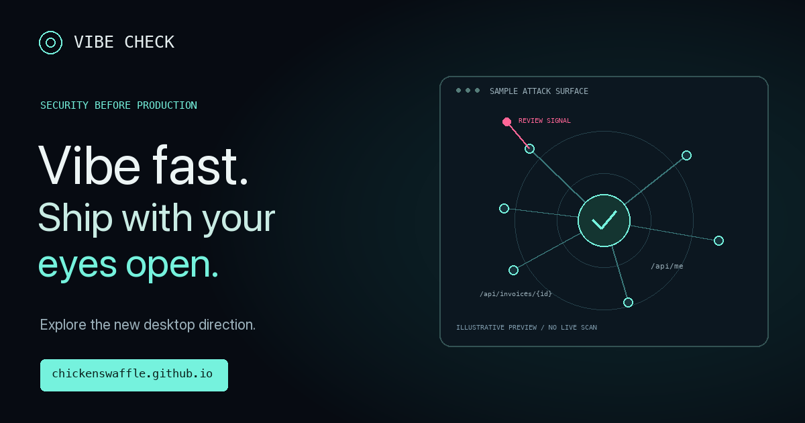

<p align="center"><a href="https://chickenswaffle.github.io/vibe-check/"></a></p>

# Vibe Check

Pre-release security checks for the apps you build fast. Try the available engine and explore the new graphical workspace direction.

**[Explore the interactive showcase →](https://chickenswaffle.github.io/vibe-check/)** · **[Download the available macOS release →](https://github.com/chickenswaffle/vibe-check/releases/tag/v0.1.0)**

```sh
brew install --cask chickenswaffle/tap/vibe-check
```

The public **v0.1.0** release is the terminal-backed macOS edition, built for Intel/x86_64. Apple Silicon requires Rosetta. Review the [release notes and installation details](https://github.com/chickenswaffle/vibe-check/releases/tag/v0.1.0); the build is not notarized.

The website's interactive attack graph previews the **new desktop direction in development**, with clearly labeled synthetic sample data. It does not run a scan in your browser. The newer assessment workspace and dual-PDF report concepts are not included in the v0.1.0 download.

## The new workspace approach — in development

- Assess only authorized targets, within an explicit scope and traffic budget.
- Inspect repeatable observations and application context. Model proposals remain hypotheses.
- Re-test the original condition; disappearance alone is not a verified fix.
- Treat unassessed behavior and incomplete checks as open coverage.

Deterministic checks can run without an AI API key. Optional OpenRouter-assisted review has separate provider data handling and spending considerations.

This repository contains the public showcase and release assets. Engine source is private. A bounded scan is not a security guarantee or compliance certification.

Built by Virobit.
